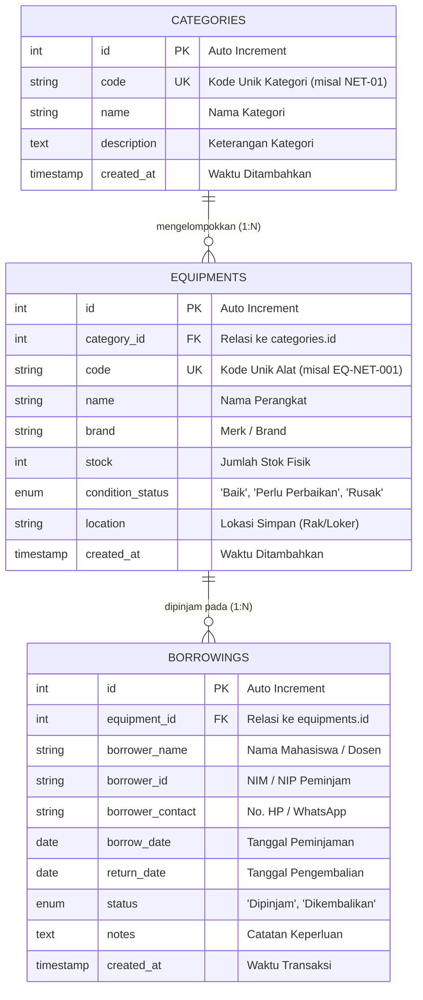
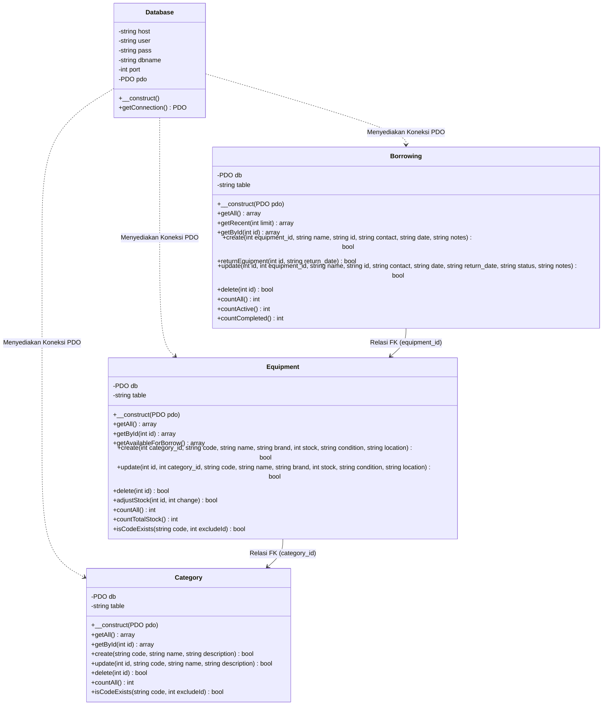
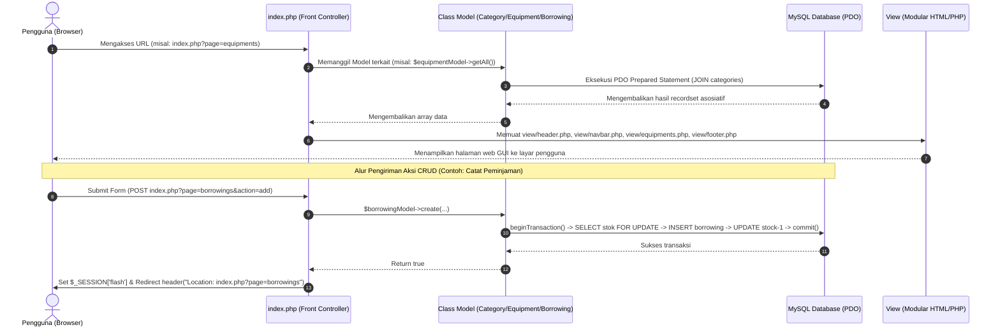
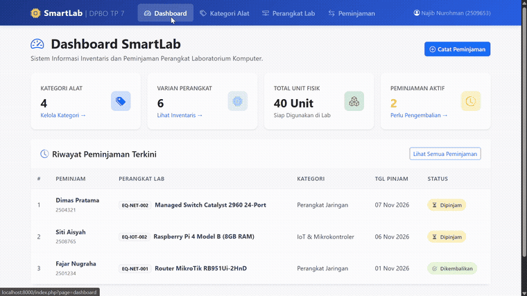
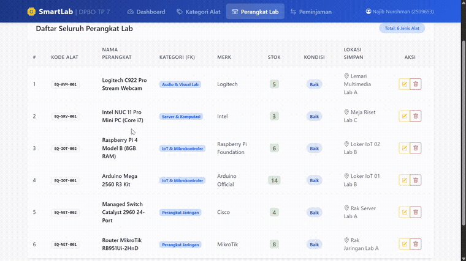
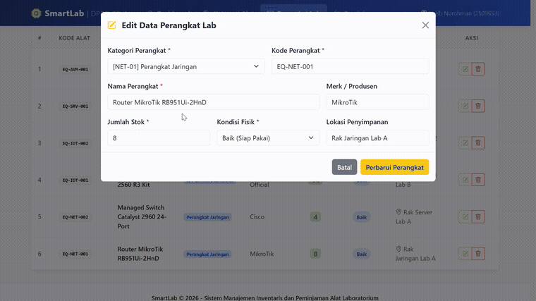

# TP7DPBO2526C1 - TUGAS PRAKTIKUM 7 DPBO (OOP PHP DENGAN GUI & DATABASE)

## JANJI
> Saya **Najib Nurohman** dengan NIM **2509653** mengerjakan **Tugas Praktikum 7** dalam mata kuliah **Desain Pemrograman Berorientasi Objek (DPBO)** untuk keberkahan-Nya maka saya tidak akan melakukan kecurangan seperti yang telah dispesifikasikan. Aamiin.

---

## DESKRIPSI SISTEM
**SmartLab** adalah aplikasi berbasis web dengan arsitektur **Object-Oriented Programming (OOP)** murni menggunakan bahasa pemrograman **PHP Native** dan driver database **PDO (PHP Data Objects)**. 

Sistem ini dirancang untuk mengelola inventarisasi aset dan transaksi peminjaman perangkat pada laboratorium komputer (seperti modul jaringan, mikrokontroler IoT, server mini, dan perlengkapan multimedia). 

### Fitur Utama Sistem:
1. **Penerapan OOP & Design Pattern**:
   - Struktur kode modular dan terorganisir rapi dalam folder `class/`, `config/`, `database/`, dan `view/`.
   - Logika bisnis, manipulasi database, dan rendering antarmuka dipisahkan secara terstruktur (Separation of Concerns).
2. **Keamanan Basis Data (100% Prepared Statement)**:
   - Seluruh operasi database (Create, Read, Update, Delete) menggunakan **PDO Prepared Statements** berparameter (`$stmt = $pdo->prepare(...)` dan `$stmt->execute([...])`) untuk mencegah serangan SQL Injection.
   - Tidak ada query mentah (raw query string) langsung.
3. **Database Transaction & Data Integrity**:
   - Transaksi peminjaman alat menerapkan `beginTransaction()`, `commit()`, dan `rollBack()` untuk menjaga sinkronisasi dan konsistensi stok alat.
   - Peminjaman baru otomatis memotong stok alat (`stock - 1`).
   - Pengembalian alat otomatis mengembalikan stok alat (`stock + 1`).
   - Penghapusan data peminjaman aktif otomatis merestorasi stok fisik alat.
4. **Relasi Foreign Key dengan CASCADE**:
   - Tabel `equipments` berelasi Foreign Key ke `categories` (`ON DELETE CASCADE ON UPDATE CASCADE`).
   - Tabel `borrowings` berelasi Foreign Key ke `equipments` (`ON DELETE CASCADE ON UPDATE CASCADE`).
5. **Fitur CRUD Penuh untuk Seluruh Entitas (3 Entitas)**:
   - **Kategori Perangkat**: Tambah, Lihat, Edit, Hapus (CRUD).
   - **Perangkat / Alat Lab**: Tambah, Lihat, Edit, Hapus (CRUD).
   - **Transaksi Peminjaman**: Tambah, Lihat, Edit, Pengembalian (Return), Hapus (CRUD).
6. **Graphical User Interface (GUI) Responsif**:
   - Menggunakan Bootstrap 5.3, Bootstrap Icons, dan custom styling `style.css`.
   - Dilengkapi dashboard statistik interaktif (card summary & ringkasan aktivitas).
   - Menggunakan modal popup dinamis untuk penginputan, pengeditan, dan konfirmasi hapus data.
   - Flash notification alert untuk feedback operasi CRUD kepada pengguna.

---

## STRUKTUR BASIS DATA & DESAIN RELASI

Aplikasi SmartLab memiliki **3 entitas tabel utama** yang saling berelasi:
1. `categories` : Menyimpan master data kategori/pengelompokan perangkat lab.
2. `equipments` : Menyimpan data unit perangkat lab dan memiliki relasi Foreign Key ke `categories`.
3. `borrowings` : Menyimpan riwayat transaksi peminjaman/pengembalian dan memiliki relasi Foreign Key ke `equipments`.

### Entity Relationship Diagram (ERD)



---

## DESAIN KELAS OOP (CLASS DIAGRAM)



---

## ALUR EKSEKUSI PROGRAM (FLOW OF CODE)

Aplikasi mengikuti arsitektur **HTTP Request-Response Cycle** dan konsep **Front Controller**:



---

## STRUKTUR FOLDER PROYEK

Sesuai dengan ketentuan pada Modul 8 Halaman 6:

```
TP 7/
│
├── class/                      # Berisi Class OOP untuk masing-masing tabel
│   ├── Category.php            # Class model CRUD untuk tabel categories
│   ├── Equipment.php           # Class model CRUD untuk tabel equipments (FK ke categories)
│   └── Borrowing.php           # Class model CRUD transaksi peminjaman (FK ke equipments)
│
├── config/                     # Berisi file konfigurasi sistem
│   └── db.php                  # Class Database untuk inisialisasi koneksi PDO
│
├── database/                   # Tempat penyimpanan skrip SQL
│   └── db_smartlab.sql         # Struktur skema tabel, relasi FK, dan seed data
│
├── docs/                       # Dokumentasi media dan gambar
│   ├── TP7_Demo.mp4            # Rekaman video pengujian lengkap (dapat diputar di GitHub)
│   └── img/                    # Animasi GIF pengujian fungsionalitas CRUD
│       ├── crud_kategori.gif   # Demonstrasi CRUD Kategori
│       ├── crud_perangkat.gif  # Demonstrasi CRUD Perangkat Lab
│       └── crud_peminjaman.gif # Demonstrasi Peminjaman & Pengembalian
│
├── view/                       # Tempat elemen antarmuka modular (GUI)
│   ├── header.php              # Header HTML, meta, dan Bootstrap 5 CSS
│   ├── navbar.php              # Navigasi utama dan flash alert notification
│   ├── dashboard.php           # Tampilan ringkasan statistik dan aktivitas lab
│   ├── categories.php          # Tampilan manajemen Kategori & Modal CRUD
│   ├── equipments.php          # Tampilan manajemen Perangkat & Modal CRUD
│   ├── borrowings.php          # Tampilan transaksi Peminjaman/Pengembalian & Modal CRUD
│   └── footer.php              # Penutup HTML, script Bootstrap 5, dan helper modal JS
│
├── index.php                   # Titik awal aplikasi (Front Controller & Routing CRUD)
├── style.css                   # Custom styling CSS modern
├── .gitignore                  # Berkas konfigurasi git ignore
└── README.md                   # Dokumentasi lengkap sistem dan panduan instalasi
```

---

## PANDUAN INSTALASI & MENJALANKAN SISTEM

### Prasyarat:
- Web server lokal: **Laragon** (direkomendasikan) atau **XAMPP**.
- **PHP versi 8.0** atau yang lebih baru.
- **MySQL / MariaDB**.

### Langkah-Langkah Menjalankan:

1. **Import Database**:
   - Buka **phpMyAdmin** (`http://localhost/phpmyadmin/`) atau MySQL client (HeidiSQL/DBeaver).
   - Eksekusi/import skrip SQL yang berada pada file:
     ```
     database/db_smartlab.sql
     ```
   - Skrip ini akan secara otomatis membuat database `db_smartlab`, tabel `categories`, `equipments`, dan `borrowings`, serta mengisikan data awal (dummy seed data).

2. **Konfigurasi Database (Jika Berbeda)**:
   - Pengaturan default pada `config/db.php`:
     - Host: `localhost`
     - Database: `db_smartlab`
     - User: `root`
     - Password: `""` (kosong)
     - Port: `3306`
   - Sesuaikan konfigurasi tersebut jika MySQL Anda memiliki password.

3. **Menempatkan Project**:
   - Jika menggunakan **Laragon**: letakkan folder ini di direktori `C:\laragon\www\TP7DPBO2526C1`.
   - Jika menggunakan **XAMPP**: letakkan di direktori `C:\xampp\htdocs\TP7DPBO2526C1`.
   - Atau langsung menggunakan **PHP Built-in Server** pada terminal VS Code:
     ```bash
     php -S localhost:8000
     ```

4. **Akses Aplikasi**:
   - Buka peramban (web browser) dan kunjungi:
     - Melalui Laragon/XAMPP: `http://localhost/TP7DPBO2526C1/`
     - Melalui PHP Built-in Server: `http://localhost:8000/`

---

## DOKUMENTASI SCREEN RECORDING PENGUJIAN CRUD

Berikut adalah dokumentasi pengujian fungsionalitas **Create, Read, Update, Delete (CRUD)** untuk seluruh entitas sistem SmartLab:

> **Berkas Video Penuh**: Anda dapat memutar atau mengunduh rekaman video demonstrasi lengkap berdurasi penuh (MP4) langsung di GitHub melalui tautan berikut:  
> [**docs/TP7_Demo.mp4**](docs/TP7_Demo.mp4)

---

### 1. Pengujian CRUD Entitas Kategori
Demonstrasi melihat daftar kategori, menambahkan kategori baru (kode: `NET-10`, nama: `Router Gacor`), serta memperbarui data kategori secara dinamis melalui modal.

<p align="center">
  
</p>

---

### 2. Pengujian CRUD Entitas Perangkat Lab
Demonstrasi melihat daftar inventaris perangkat lab yang terhubung dengan relasi Foreign Key ke Kategori, status kondisi fisik, pembaruan data alat, dan pengelolaan stok.

<p align="center">
  
</p>

---

### 3. Pengujian Transaksi Peminjaman & Pengembalian Alat
Demonstrasi pencatatan peminjaman baru (atas nama Najib Nurohman, NIM 2509653) yang secara otomatis mengurangi stok fisik alat sebesar 1 unit, verifikasi status pada dashboard, serta eksekusi pengembalian alat yang secara otomatis mengembalikan stok fisik alat sebesar 1 unit dengan notifikasi sukses.

<p align="center">
  
</p>

---

## IDENTITAS PENGEMBANG

| Keterangan | Detail |
|---|---|
| **Nama Mahasiswa** | Najib Nurohman |
| **NIM** | 2509653 |
| **Kelas** | C1 |
| **Mata Kuliah** | Desain dan Pemrograman Berorientasi Objek (DPBO) |
| **Program Studi** | Ilmu Komputer |
| **Fakultas** | FPMIPA - Universitas Pendidikan Indonesia (UPI) |
| **Format Repositori** | `TP7DPBO2526C1` |
